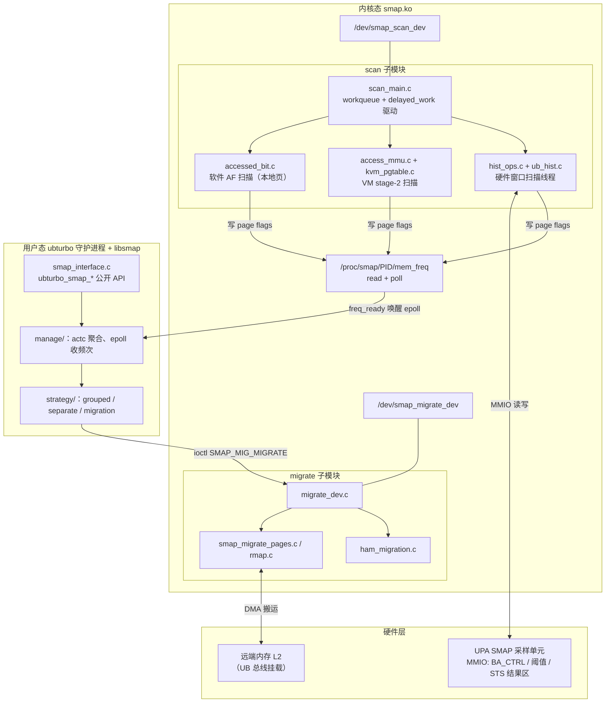
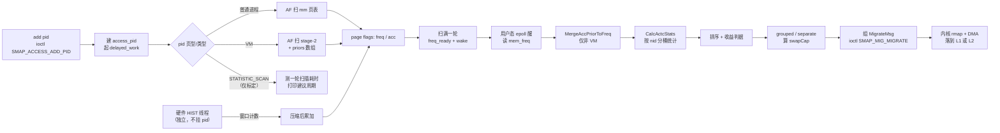

# UBTurbo SMAP 架构与实现原理

分析对象：`/Users/cheney/work/code/ubturbo` 的 SMAP 组件。行号基于当前工作副本实测。

> 配套笔记：[[UBTurbo SMAP 冷热判断与交换速率]]（讲计数器细节、交换速率公式、参数与部署）。

## 0. 一句话结论

**SMAP 是一个"内核扫描 + 用户态决策"的分体式系统**：内核 `smap.ko` 只负责回答"每个页有多热"（软件 AF 扫描 / 硬件 HIST 扫描 / KVM stage-2 扫描），把结果通过 `/proc/smap/<pid>/mem_freq` 交给用户态；用户态 `libsmap` 才做排序、阈值判断、交换量计算，最后用 ioctl 把迁移清单丢回内核执行。

**冷页和热页不是两套扫描器，而是同一份频次数据的两侧解读**：本地节点（L1）的页按频次升序 = 冷页候选，远端节点（L2）的页按频次降序 = 热页候选。差别只在扫描手段——本地页走软件 AF，远端页可以再叠加硬件 HIST。

## 1. 架构图



**分层要点**：

| 层 | 职责 | 入口 |
| --- | --- | --- |
| 硬件 | 只有 HIST 模式才用；提供"窗口访问计数" | MMIO 寄存器 |
| 内核 scan | 把访问信息落成 `page->flags` 里的 `freq`/`acc` | `/dev/smap_scan_dev`（`plugins/smap/src/kernel/scan/scan_ioctl.h:17`） |
| 内核 migrate | 真正搬页（含 rmap、一致性维护、UB DMA） | `/dev/smap_migrate_dev`（`plugins/smap/src/kernel/migrate/migrate_dev.h:20`） |
| 用户态 | 聚合、排序、阈值、算交换量 | `/proc/smap/<pid>/mem_freq` |

两个字符设备把"扫描"和"迁移"彻底拆开：扫描走一个口子，迁移走另一个口子，中间靠 `/proc` 传数据。

## 2. 框架图：一轮决策的数据流



一轮完整节拍（默认参数下）：

1. 用户态下发 `add pid`，内核按 `scan_time` 起延迟工作（`submit_one_work()`，`plugins/smap/src/kernel/scan/scan_main.c:279`，`queue_delayed_work` 在 `:292`）。
2. 每轮跑到 `access_work_func()`（`plugins/smap/src/kernel/scan/scan_main.c:465`），按 `SMAP_PID_VM` 分流到 stage-2 扫描或普通 mm 扫描（`:514` / `:516`）。
3. 只要 `cur_times < ntimes` 就自己续一轮（`:538-541`）；普通扫描跑满后置 `freq_ready = true` 并唤醒等待者（`:546-548`，仅 `NORMAL_SCAN`）。
4. 用户态通过 epoll 监听该 procfs 文件（`plugins/smap/src/user/manage/thread.c:71`、`:82`），醒来读 actc 数组。
5. 用户态聚合 → 统计 → 排序 → 算交换量 → ioctl 下发迁移。

第 3 步是关键设计：**内核不推送数据，只在"这一批扫描轮次扫完"时点亮一个可 poll 的标志**，用户态自己来取。这样内核侧没有队列、没有背压问题。

**三个容易画错的地方**（都按代码核实过）：

- **硬件 HIST 线程不是 pid 扫描的一部分**。它是 `hist-scan-thread` 常驻线程（`plugins/smap/src/kernel/scan/hist_ops.c:1372`），只扫远端 RAM 区段，把结果直接累加进 `page->flags`，与按 pid 驱动的 AF 扫描**并行**，最后汇进同一条 `/proc` 出口。
- **`STATISTIC_SCAN` 不是硬件热页通路**。它只统计页数并打印建议扫描周期（`plugins/smap/src/kernel/scan/access_pid.c:1109-1113`），是标定模式；`access_walk_pagemap_prepare()` 对非 `NORMAL_SCAN` 直接返回（`:1449-1451`）。
- **`freq_ready` 只对 `NORMAL_SCAN` 置位**（`plugins/smap/src/kernel/scan/scan_main.c:546`），所以拖 procfs 的是普通扫描；`STATISTIC_SCAN` 走的是耗时统计，不给频次。

## 3. 冷页扫描：本地页，软件 AF

### 3.1 机制

利用 ARM64 的 PTE Access Flag：内核遍历目标进程的页表，读出 AF 并**清零**，下一轮再看它有没有被重新置上。

- 一轮内被访问过 → AF=1 → `smap_page_freq_inc(pg)`（`plugins/smap/src/kernel/scan/accessed_bit.c:1484`）
- 普通扫描还会对匿名页累加"跨轮累计热度" `acc`：仅 `NORMAL_SCAN` 且非文件/共享页，调 `smap_page_acc_inc()`（`plugins/smap/src/kernel/scan/accessed_bit.c:1488-1491`）

AF 读清语义在 `plugins/smap/src/kernel/scan/smap_page_flags.h:109-128`，自增在 `:133`。

### 3.2 为什么"冷页"是这么来的

本地节点（L1）的页扫完一轮后，频次低的页就是"近期没怎么用"——它们继续占着贵的本地内存不划算，是**迁出到远端（L2）的候选**。

排序口径在用户态：本地页按 `freq` 升序（`plugins/smap/src/user/strategy/grouped_strategy.c:527`），最冷的排最前。

### 3.3 VM 的差异

虚机不能直接走宿主 mm 页表，改走 KVM stage-2：

- `scan_accessed_bit_forward_vm()`（`plugins/smap/src/kernel/scan/scan_main.c:514`）→ `plugins/smap/src/kernel/scan/access_mmu.c` + `kvm_pgtable.c`
- VM 的 `prior` 不是内核自己衰减出来的，而是走一个前端采样数组（`access_mmu.c` 里填 `info->priors`），语义和普通进程的 `prior` 不同

## 4. 热页扫描：远端页，软件 + 硬件

远端页的扫描有三种模式，由 `smap.remote.scan.mode` 控制（枚举见 `plugins/smap/src/kernel/scan/scan_main.h:26-29`）：

| 值 | 名称 | 远端频次来源 |
| --- | --- | --- |
| 0 | `SMAP_REMOTE_SCAN_SOFT` | 仅软件 AF |
| 1 | `SMAP_REMOTE_SCAN_COMBINED`（**默认**） | 软件 AF + 硬件 HIST **叠加** |
| 2 | `SMAP_REMOTE_SCAN_HARD` | **仅**硬件 HIST |

判断函数：`is_remote_scan_hist_active()`（`plugins/smap/src/kernel/scan/scan_main.c:82`）、`is_freq_hist_only_node()`（`:88`）。后者限定 `node >= nr_local_numa`——**硬件只管远端节点，本地页永远走软件**。

纯硬模式的开关点就在 AF 扫描里（`plugins/smap/src/kernel/scan/accessed_bit.c:457`）：

```c
/* Pure HW mode: remote freq comes from hardware only; other modes add
 * software accumulation.
 */
if (!is_freq_hist_only_node(nid))
    smap_page_freq_inc(page);
```

即：默认的软硬结合模式两边都加，纯硬模式软件侧跳过，交给硬件。

### 4.1 硬件 HIST 怎么工作

一句话：**配置采样单元扫一段地址区间，读回"每个窗口被访问多少次"的直方图，压缩后累加进页的 `freq`。**

时序是同步轮询（不用中断）：下发 `BA_CTRL` → 睡眠 `scan_time` → 关采样 → 读整块 STS 结果区（`plugins/smap/src/kernel/scan/hist_ops.c:805-828`）。扫描线程连续轮转（`plugins/smap/src/kernel/scan/hist_ops.c:1372`）。

落到页上的链条：窗口计数 → 按内核页聚合求和 → `floor(sqrt(raw))` 压缩 → `smap_page_freq_add()`（`plugins/smap/src/kernel/scan/hist_ops.c:656`）。细节见 [[UBTurbo SMAP 冷热判断与交换速率]] §1.6。

### 4.2 为什么远端要用硬件

软件 AF 扫远端页的代价来自两处：页表遍历本身，以及远端内存的 PTE 读写延迟。硬件采样单元直接在内存侧统计，不占 CPU、不碰页表——这就是 HIST 存在的理由。文档也明确：HIST 不可用时要**回退到软件路径**，不能因为有硬件就砍掉软件扫描（`docs/smap/performance_algorithm.md`）。

一个反例：纯硬模式虽然省 CPU，但丢掉了本地页那一半信息——所以本地页无论如何都得软件扫。

## 5. 从频次到迁移决策

内核把结果暴露成 `/proc/smap/<pid>/mem_freq`（`mem_freq_read()`，`plugins/smap/src/kernel/scan/access_pid.c:598`；`poll` 在 `:661`；目录创建在 `:708`）。

用户态拿到的是按 NUMA 节点分桶的 actc 数组——分桶边界就是 `nr_local_numa`（`fill_actc_data_by_bitmap()`，`plugins/smap/src/kernel/scan/access_pid.c:459`，`:470-476`）：

```c
page_count = nid < nr_local_numa
                 ? get_node_page_count(nid)
                 : remote_ram_snapshot_page_count(ap->remote_snapshot, nid, page_size);
```

**这一行就是"冷/热两侧"的代码依据**：节点号小于本地 NUMA 数 = 本地内存（冷页来源），否则查远端快照（热页来源）。

同一套 `nid < nr_local_numa` 判断在扫描侧也出现一次，说明分桶口径是全局一致的（`plugins/smap/src/kernel/scan/accessed_bit.c:432`、`:436`）：先把物理地址反查成 NUMA 节点，再决定用本地的 acidx 计算还是远端快照的。

之后用户态：

1. `MergeAccPriorToFreq()` 合成决策分数（`plugins/smap/src/user/manage/manage_scan.c:139-146`，仅非 VM）
2. `DistributeActcData()`（`:157`）→ `CalcActcStats()`（`:248`）统计
3. `RunStrategy()` 分发（`plugins/smap/src/user/strategy/strategy.c:101-115`）→ grouped 或 separate
4. 组 `MigrateMsg`，走 `SMAP_MIG_MIGRATE`（`plugins/smap/src/user/manage/smap_ioctl.h:51`）下发到 `/dev/smap_migrate_dev`

## 6. 关键接口一览

| 方向 | 接口 | 位置 |
| --- | --- | --- |
| 用户 → 内核（扫描） | `ioctl(SMAP_ACCESS_ADD_PID)` | `plugins/smap/src/user/manage/access_ioctl.c:24`、`:64` |
| 用户 → 内核（迁移） | `ioctl(SMAP_MIG_MIGRATE)` | `plugins/smap/src/user/manage/smap_ioctl.h:51` |
| 内核 → 用户（频次） | `/proc/smap/<pid>/mem_freq` + poll | `plugins/smap/src/kernel/scan/access_pid.c:598`、`:661` |
| 用户态事件循环 | epoll 注册该 procfs | `plugins/smap/src/user/manage/thread.c:71`、`:82` |
| 对外 SDK | `ubturbo_smap_*` | `plugins/smap/src/user/smap_interface.h:175-371` |

## 7. 设计上的三个取舍

1. **扫描与决策分离**：内核只产数据不做决策，策略改起来不用改内核模块。代价是每个扫描窗口一次 procfs 读取 + 用户态唤醒。
2. **冷热共用一套计数器**：本地 AF、远端 AF、硬件 HIST 全写进同一个 `page->flags` 的 `freq` 字段，读者只认一个数。代价是量纲不统一，必须靠 `freqWt` 归一（这也是文档反复强调"不能直接比较"的原因）。
3. **远端扫描可选硬件**：软硬结合是默认，纯硬更省 CPU 但只剩远端一半视野，纯软最兼容但要吃页表遍历开销。

## 8. 未验证

- 三种远端扫描模式在真实负载下的收益对比，**未实测**。
- VM 的 `priors` 前端采样数组由谁、以什么节奏填充，只确认了它在 `access_mmu.c` 里被写，**未逐行核对完整链路**。
- HIST 硬件计数与软件 AF 的换算关系无成文公式，靠 `freqWt` 自动推导。

## 9. 相关

- [[UBTurbo SMAP 冷热判断与交换速率]]
- [[ARM64 TLBI 与 x86 TLB 失效]]
- [[Firecracker microVM 在 ARM 上的 TLB 刷新时机]]
