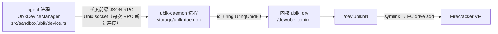

# Ublk 设备管理

AgentENV 的 ublk 设备管理全流程：架构分层、创建/挂接/运行期/释放/恢复，及 volume 专项。底层 overlaybd/LSMT 原语见 [[OverlayBD 与 LSMT 机制]]，调用方上下文见 [[沙箱拉起全流程]] 与 [[Pause-Resume 流程与代码地图]]。

## 1. 架构分层

| 组件 | 锚点 | 职责 |
| --- | --- | --- |
| agent 侧管理器 | `src/sandbox/ublk/device.rs:183` | 生命周期编排、共享只读设备池；**从不直接碰内核** |
| daemon | `storage/ublk-daemon/src/server.rs:272` | 唯一内核代理：持 /dev/ublk-control 与所有 /dev/ublkcN；设备表、warm pool、restack、resize、pack recording |
| uvm_ublk 库（仅 daemon 链接） | `storage/ublk/src/ctrl.rs:199`、`storage/ublk/src/dev.rs:96` | 控制命令（ADD/START/STOP/DEL_DEV）、每队列独立线程+io_uring（不共享 ring 的原因 `storage/ublk/src/dev.rs:283-288`） |
| OverlaybdTarget | `storage/ublk/src/impls/overlaybd_target.rs:48` | OverlayBD 开镜像 → 块设备 target |

**RPC**：4 字节大端长度 + JSON，单消息上限 16MiB（`storage/ublk-daemon/src/protocol.rs:12`）；消息枚举 `:18-113`（CreateOverlaybdRuntimeDevice/Delete/RestackSnapshot/NotifySandboxReady/PackRecording/Prefetch/Acquire·Release/UpdateSize 等）；错误三档 TerminalError/InvalidRequest/Error（`:159-203`）。

**daemon 生命周期**：agent 启动时 spawn（`src/bin/server.rs:97-101` → `src/sandbox/ublk/device.rs:217-250` → `storage/ublk-daemon/src/client.rs:153-242`）——清 stale socket（`storage/ublk-daemon/src/client.rs:167`）、CAP_SYS_ADMIN scoping（`storage/ublk-daemon/src/client.rs:26-42`）、独立进程组、等 stdout "ready" 30s（`storage/ublk-daemon/src/client.rs:272-306`）、watchdog。daemon 侧监听 SIGTERM/SIGINT/**父进程 pidfd**（`storage/ublk-daemon/src/main.rs:347-384`）——**daemon 与 agent 同生共死，不存在独立重启**。RLIMIT_NOFILE 提到 1M（`storage/ublk-daemon/src/main.rs:265-268`）。

## 2. 设备创建流（所有入口）

### 2.1 rootfs（冷启）

入口 `src/sandbox/firecracker/sandbox.rs:1871-1883` → agent RPC `src/sandbox/ublk/device.rs:456-478`（超时 max(360s, resize+120s)，`src/sandbox/ublk/device.rs:24`）→ daemon：

| daemon 步 | 锚点 | 说明 |
| --- | --- | --- |
| 物化 runtime 目录 | `storage/ublk-daemon/src/runtime.rs:124-139` | `claim` 用 create_dir 原子占位（必须不存在 `:47`）；失败 rollback 整目录 `:134` |
| upper 决策 | `storage/ublk-daemon/src/runtime.rs:180`、`:496-550` | read_only→Absent；源 image.json 已带合法 upper→Existing 复用；否则 Create 新 upper |
| 重写 image.json | `storage/ublk-daemon/src/runtime.rs:209-220` | lowers 重写为 runtime 相对路径，注入 upper |
| resize（可选） | `storage/ublk-daemon/src/runtime.rs:222-252` | GiB 对齐、须 fresh upper；overlaybd-resize 子进程全局串行（`:234`） |
| 建设备 | `storage/ublk-daemon/src/server.rs:790-818` | pool 开启→acquire(Exclusive)；否则 create |
| 内核交互 | `storage/ublk-daemon/src/server.rs:873-936` | open 镜像→ADD_DEV（dev_id=u32::MAX 内核分配）→开 cdev→`dev.start()`（`storage/ublk/src/dev.rs:326-360`）→等 /dev/ublkbN 可读 ~30s（`storage/ublk/src/lib.rs:65-100`，容忍 udev）→登记 DashMap |

返回 `{dev_id, device_path=/dev/ublkbN, actual_virtual_size, runtime_image_config_path}`（`storage/ublk-daemon/src/protocol.rs:164`）。

### 2.2 其余入口

| 入口 | 锚点 | 说明 |
| --- | --- | --- |
| rootfs resume | `src/sandbox/firecracker/sandbox.rs:2107-2119` | requested=known=快照值，allow_shrink=false |
| extra drives | `src/sandbox/extra_drive.rs:432-531` | 逐盘 create；runtime_dir=`extra-drive-runtime-{id}`；**部分失败逐盘回滚** `:514-523` |
| volumes | `src/api/impls/volumes.rs:60-118` → `src/sandbox/extra_drive.rs:44-45` | volume=带 `volume=true` 标记的 ExtraDrive；ro 卷 read_only=true，exclusive 挂 snapshot_output_dir |
| **共享只读 mem 设备** | `src/sandbox/firecracker/sandbox.rs:2308-2317` → `src/sandbox/ublk/device.rs:606-654` | 同快照多沙箱复用：key=canonicalize(image_config)；先等 in-flight 释放（`:619-637`），Weak upgrade 快路径 |
| **cache_fd 保页缓存** | `src/sandbox/ublk/device.rs:682-688`、`:745-749` | agent 持 /dev/ublkbN 打开 fd：内核最后关闭者会 kill_bdev 清页缓存，保 fd 即跨沙箱共享页缓存 |
| 专用 mem 设备 | `src/sandbox/ublk/device.rs:377-382` | pack-recording 用，不入共享表（避免首触记录被污染） |
| tools 盘 | `src/sandbox/ublk/device.rs:591-604` | 共享只读；manager 另保留 recent_tools_device 空闲句柄跨启动复用 |

## 3. Firecracker 挂接

| 盘 | 方式 | 锚点 |
| --- | --- | --- |
| tools=vda | `add_drive("rootfs", …, read_only=true, IoEngine::Sync)` | `src/sandbox/firecracker/sandbox.rs:2505-2522`；add_drive→FC `PUT /drives/{id}`（`src/sandbox/firecracker/instance.rs:317-335`） |
| 用户 rootfs=vdb | 可写 + 磁盘限速器（预启动生效） | `src/sandbox/firecracker/sandbox.rs:2524-2537` |
| extra drives/vdc… | symlink + drive add | `src/sandbox/firecracker/sandbox.rs:2593-2610` |
| **volume 保留槽** | fresh boot 即建 4KB 占位槽（FC 快照恢复后不能新增 virtio-blk），实际卷 load 前替换占位 | `src/sandbox/firecracker/sandbox.rs:2612-2660`；槽上限 24（`src/sandbox/firecracker/config.rs:55`） |
| **内存恢复不走 drive** | FC `load_snapshot_file(mem_device_path=/dev/ublkbN)` 从块设备读内存镜像 | `src/sandbox/firecracker/sandbox.rs:2356-2364` |
| resume 时新卷 | 加载后 `PATCH /drives` 换路径 | `src/sandbox/firecracker/sandbox.rs:2366-2387` |

## 4. UblkDeviceManager（agent 侧）

| 机制 | 锚点 | 说明 |
| --- | --- | --- |
| 单例与状态 | `src/sandbox/ublk/device.rs:197`、`:183-195` | client、pool_enabled、共享设备表（DashMap<PathBuf, Weak>）、in-flight 释放等待表 |
| 引用计数 | `src/sandbox/ublk/device.rs:834-877` | Arc 句柄克隆即计数；最后引用 Drop（`:752-799`）detached 异步释放（避免阻塞 drop 路径） |
| 释放/获取串行化 | `src/sandbox/ublk/device.rs:619-637`、`:801-828` | 同 key 上次释放未完成时新 acquire 等待，防 daemon 复用 stale 状态 |
| release vs delete | `src/sandbox/ublk/device.rs:315-334`、`:480-501` | pool 开→ReleaseOverlaybd 回池；否则 Delete；**dedicated mem 设备必须 delete** |
| COW 语义 | `src/sandbox/ublk/device.rs:47-66` | legacy "Cow" 后端已移除；OverlayBD lowers(不可变)+可写 upper 即逻辑 COW，restack seal 把 upper 固化为 lower |
| 共享并发竞争 | `src/sandbox/ublk/device.rs:703-728`；daemon `storage/ublk-daemon/src/server.rs:1616-1637` | entry API 防覆盖；daemon 撞车销毁多余设备 |
| 指标 | `src/sandbox/ublk/device.rs:899-926` | operation_duration 按 create/release/restack 标签；restack 顺带记录 overlaybd/ext4 用量 gauge |
| 配置 | `src/cfg.rs:468-500` | daemon_binary/socket_path、overlaybd.global_config_path/runtime_upper_mode/allow_shrink/resize_timeout |

## 5. daemon 侧设备表与 warm pool

- 非 pool：`devices: DashMap<u32, ManagedDevice>`（`storage/ublk-daemon/src/server.rs:277`）
- pool：`PoolState`（`storage/ublk-daemon/src/server.rs:137-166`）——idle WarmPool、active_exclusive（dev_id 索引）、active_shared（(image_config,global_config) 索引+refcount）、shared_by_dev_id 反向索引（避免 iter_mut 死锁）、image_locks
- 共享 acquire refcount：`storage/ublk-daemon/src/server.rs:1575-1598`
- release 回池：BLKFLSBUF 清页缓存 + 换 daemon-owned placeholder（不 pin 业务镜像）（`storage/ublk-daemon/src/server.rs:2025-2056`；回池或超 high watermark 销毁 `:1834-1851`）
- refill：inflight 合并、失败 1s 退避（`storage/ublk-daemon/src/server.rs:1853-1928`）；startup_prewarm 依赖 UPDATE_SIZE（`storage/ublk-daemon/src/main.rs:331-339`）
- 动态扩缩：UpdateSize RPC 须 UBLK_F_UPDATE_SIZE（`storage/ublk-daemon/src/server.rs:1782-1821`；feature 位 `storage/ublk/src/ublk_caps.rs:22`），不支持时按同尺寸取池

## 6. 运行期操作

| 操作 | 锚点 | 说明 |
| --- | --- | --- |
| notify_sandbox_ready | agent `src/sandbox/ublk/device.rs:294-310`；调用点 `src/sandbox/firecracker/sandbox.rs:992-1010`；daemon `storage/ublk-daemon/src/server.rs:623-630` | best-effort；释放 overlaybd download_gate 挂起的后台下载 |
| pack recording | `src/sandbox/ublk/device.rs:385-414` → `storage/ublk-daemon/src/server.rs:985-1080`；窗口状态机 `:1182-1262`；abort 幂等 `:1153-1180` | 仅 dedicated mem 设备；fail-safe 防泄漏 |
| startup pack prefetch | `src/sandbox/ublk/device.rs:419-454`；daemon `storage/ublk-daemon/src/server.rs:1102-1146` | best-effort 永远 Ok |
| **restack（封存）** | agent `src/sandbox/ublk/device.rs:504-554`；daemon `storage/ublk-daemon/src/server.rs:1373-1437` | 三处查表→image_lock 写锁（与 open 互斥）→`create_snapshot_and_restack`；**丢回复也按 terminal 处理**（`storage/ublk-daemon/src/client.rs:878-899` 测试） |
| rootfs 快照编排 | `src/sandbox/firecracker/overlaybd_snapshot.rs:598-651`；`src/sandbox/firecracker/sandbox.rs:1321-1346` | ro 盘跳过 restack 只 stage 配置；捕获后源恢复运行 |
| volume 快照编排 | `src/sandbox/firecracker/sandbox.rs:602-654`（guest fsfreeze，RPC 失败=terminal）、`:2743-2772`（逐 exclusive 盘 restack 到 data_dir）、失败 thaw `:638-648` | |

## 7. 释放与清理顺序

**单沙箱 stop()**（`src/sandbox/firecracker/sandbox.rs:1472-1569`，顺序有约束，注释 `:1500`）：prefetch 取消 → FC stop → envd invalidate → **rootfs release**（FC stop 后）→ tools release → dedicated mem **delete** → extra drives → extension stop → 网络 slot → mem 共享设备 release。

- Drop 兜底（未 stop）：daemon 模式下只 take 句柄不发 RPC（`src/sandbox/firecracker/sandbox.rs:1784-1806`），设备交由 daemon shutdown/显式 stop 清理
- daemon Delete：先 abort recording → 移表 → `quiesce`（STOP_DEV+5s 等队列线程，`storage/ublk-daemon/src/server.rs:1264-1279`）→ **drop ManagedDevice（关 cdev fd）后才能 DEL_DEV，否则 ioctl 卡死**（`:954-957`）
- daemon shutdown：16 并发对 devices+pool 三表逐设备 quiesce+DEL_DEV（`storage/ublk-daemon/src/server.rs:468-546`）；agent 侧 shutdown 顺序中 `shutdown_daemon` 最后（`src/bin/server.rs:191-220`）
- FC 进程退出只是 /dev/ublkbN 的一个打开者：设备与页缓存归属 daemon 与 agent cache_fd

## 8. 恢复与孤儿（负面结论，均经核对）

- 协议**无 "list devices" RPC**（`storage/ublk-daemon/src/protocol.rs:18-113` 全枚举）；agent 除共享池 Weak 表外不维护设备注册表
- daemon **不可独立重启**：pidfd 绑定父进程；daemon 意外死亡→watchdog 置 dead，后续 RPC 全失败（`storage/ublk-daemon/src/client.rs:692-711`），无自动 respawn；内核残留设备无代码清理路径；UBLK_F_RECOVERY 未使用
- agent 重启恢复仅 volume 逻辑层：`recover_backings` 重建 node-local image.json、缺失置 Failed（`src/volume.rs:665-703`，orchestrator 启动时调用 `src/orchestrator/service.rs:344`）；**ublk 设备层无恢复** —— 这是 [[Rootfs Retention 一期设计]] 中"retained 设备活不过 daemon 重启"结论的根据

## 9. Volume 专项（设备层视角）

| 规则 | 锚点 |
| --- | --- |
| 删除拒绝：被 exclusive 预留或 ro 挂载→Reserved | `src/volume.rs:448-455` |
| 新挂载拒绝 Uploading/Failed | `src/volume.rs:572-577`；错误→409 映射 `src/api/impls/volumes.rs:147-166` |
| fork：exclusive 每子 create_child，ro 共享；失败 `cleanup_fork_volume_children` | `src/api/impls/sandbox.rs:191-269` |
| 快照恢复重建卷，失败清理 | `src/api/impls/sandbox.rs:292-310` |
| 快照捕获先发布最新 restack 层 | `src/volume.rs:551-570` |
| 挂载重复/重叠/上限检查 | `src/api/impls/volumes.rs:60-84` |

## 10. 失败与并发汇总

| 场景 | 行为 | 锚点 |
| --- | --- | --- |
| daemon 不可用 | fail-fast；resume 前置预检 | `src/sandbox/ublk/device.rs:285-289`；`src/sandbox/firecracker/sandbox.rs:2042-2046` |
| RPC 超时 | 30s 默认 / 360s 快照 | `storage/ublk-daemon/src/client.rs:18-24` |
| 建设备中途失败（内核） | STOP_DEV(容忍 ENODEV)→等队列→drop→DEL_DEV | `storage/ublk-daemon/src/server.rs:1281-1354` |
| rootfs symlink 失败 | 立即 release 已建设备 | `src/sandbox/firecracker/sandbox.rs:1888-1898` |
| restack 结果未知 | terminal→teardown；可恢复→重新 resume，失败升级 | `src/sandbox/ublk/device.rs:533-553`；`src/sandbox/firecracker/sandbox.rs:733-748` |
| restack vs open 并发 | per-image RwLock | `storage/ublk-daemon/src/server.rs:148-150` |

## 11. 内核前提

| 项 | 锚点 | 说明 |
| --- | --- | --- |
| 模块检测/加载 | `storage/ublk/src/ctrl.rs:19-35`、`:62-79` | /sys/module/ublk；modprobe→sudo -n modprobe 兜底 |
| setup-host | `src/setup/ublk.rs:73-83` | 缺模块 apt 装 linux-modules-extra → load → /etc/modules-load.d 持久化 `:97-118` |
| udev 规则 | `src/setup/ublk.rs:14-34` | 0660+runtime group；ublkb* scheduler=none；reload+trigger+settle `:36-64` |
| 启动校验 | `src/setup/mod.rs:105-154`；`src/bin/server.rs:94` | 模块已载 + /dev/ublk-control 可读写 |
| 版本要求 | pidfd 需 5.3+（`storage/ublk-daemon/src/main.rs:397-402` 注释）；UPDATE_SIZE 为较新特性；GET_FEATURES 不支持降级禁 resize | `storage/ublk-daemon/src/server.rs:1944-1971` |
