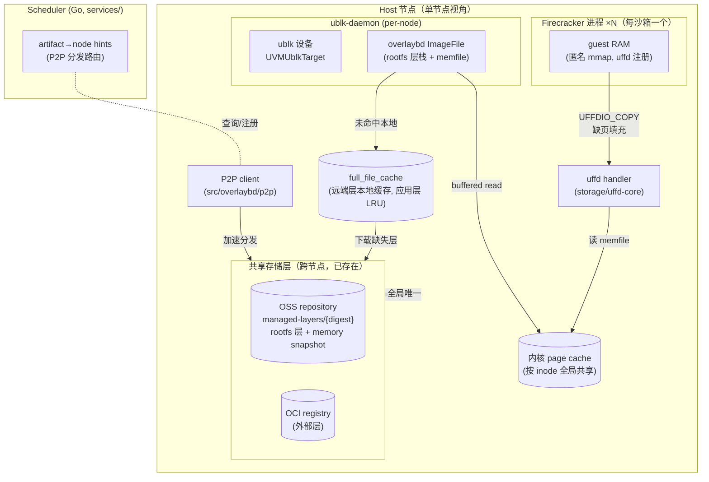
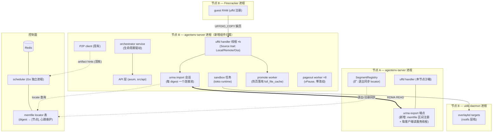
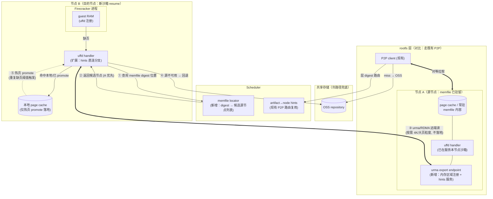
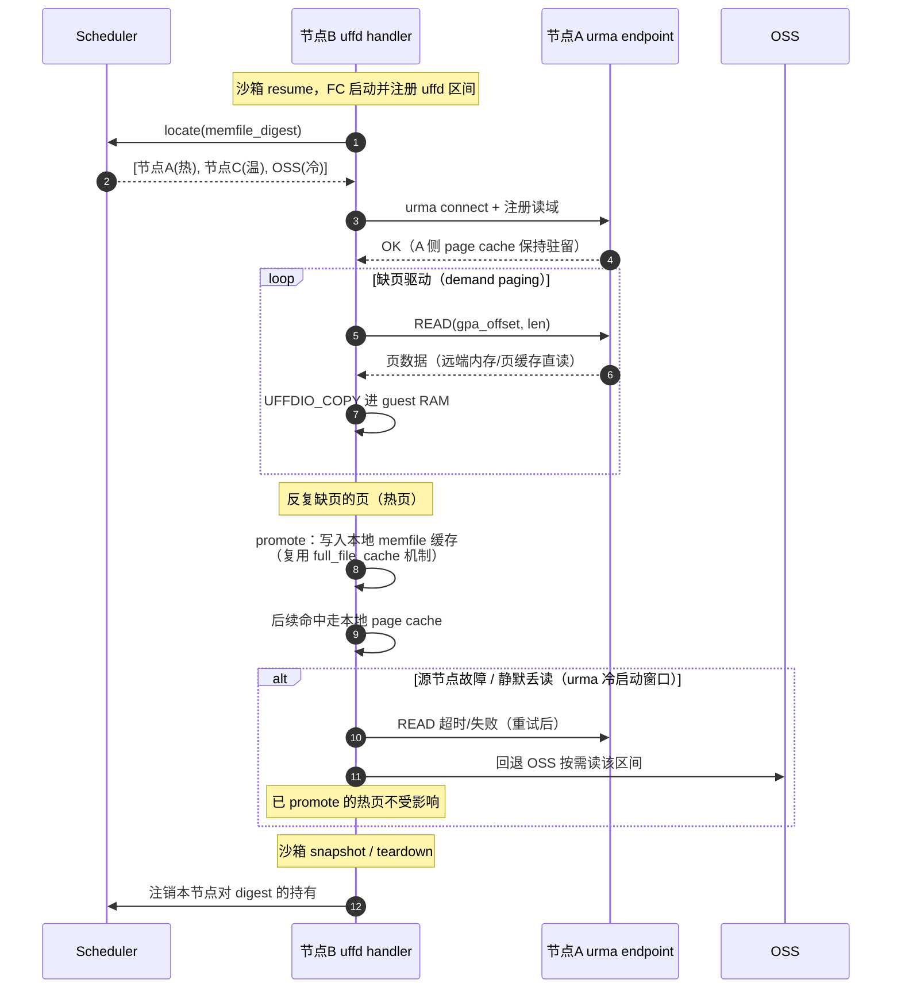
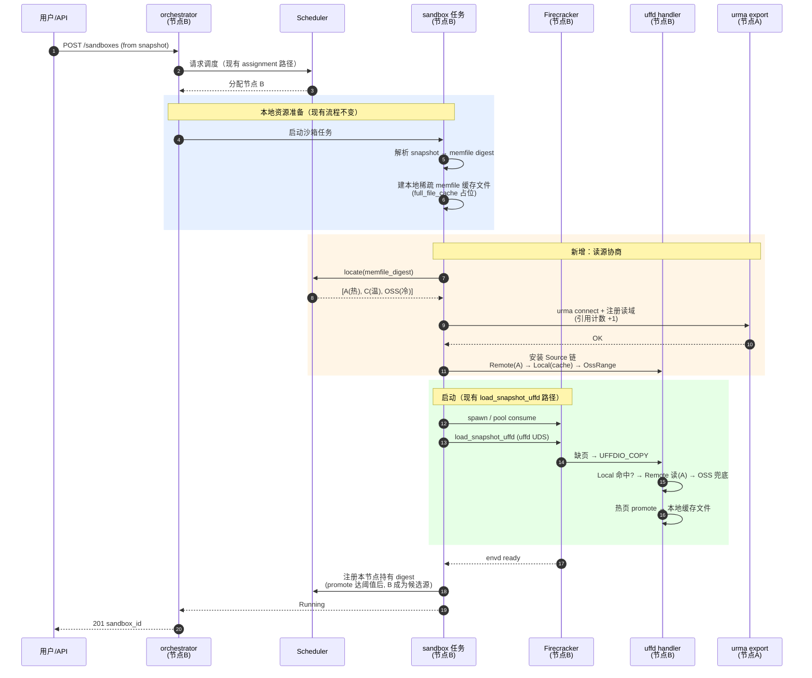
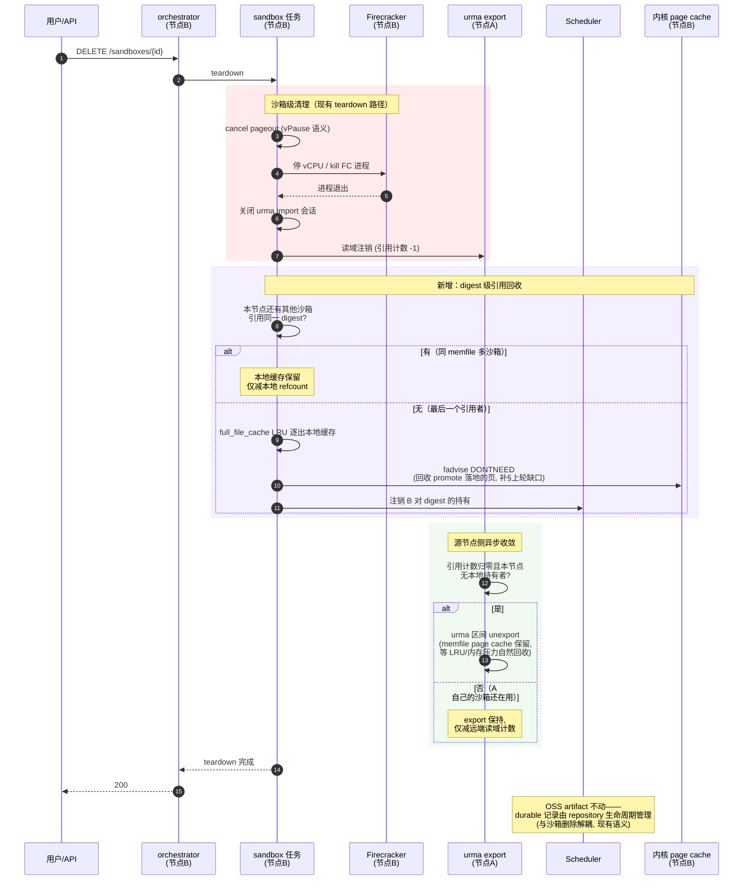
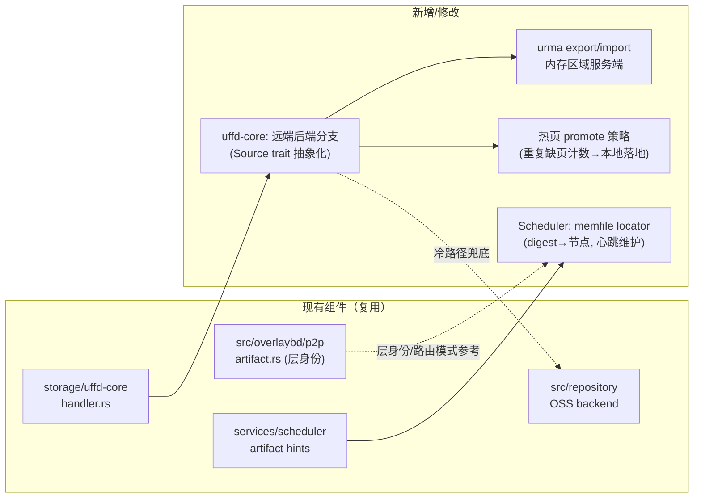

# AgentENV rootfs / memfile 跨节点共享 — 开发者视图设计

> 基于 master_main 代码现状（v0.2.5+）的设计文档。Mermaid 图可直接在 GitHub / VS Code 预览。

---

## 1. 现状：单节点内的共享结构（开发者组件视图）



**现状共享语义小结：**

| 资源 | 节点内共享 | 跨节点共享 |
| --- | --- | --- |
| rootfs 不可变层 | page cache 按 inode 共享（同节点多沙箱一份） | **已实现**：内容寻址 + OSS 全局唯一 + P2P 加速分发 |
| memfile（memory snapshot） | page cache 按 inode 共享（uffd COPY 源） | **仅数据可达**（artifact 在 OSS）；热路径无共享 —— resume 必须 uffd COPY，副本每节点一份 |
| 可写 upper 层 | 不共享（沙箱私有） | 不应共享（per-sandbox 状态） |

**核心缺口**：memfile 的跨节点共享只有"下载整个文件"一种形态。节点 B 上的沙箱 resume 时，即使节点 A 的内存里已经有这份 memfile（page cache / 常驻），B 也必须从 OSS 拉全量或本地缓存副本。

---

## 1.5 进程视图（跨节点共享落地后的进程/线程布局）



**进程归属要点：**

| 组件 | 进程 | 线程模型 |
| --- | --- | --- |
| uffd handler（Source trait 三实现） | agentenv-server | 缺页服务线程 ×k（现有模式扩展），**不进 ublk-daemon**——memfile 读源与块设备数据面解耦 |
| urma export | agentenv-server（源节点） | 每远端客户端一个服务线程；内存区间注册引用计数 |
| urma import | agentenv-server（目的节点） | 连接池，与 uffd 服务线程共享读域 |
| promote worker | agentenv-server | 复用 full_file_cache 写入路径（缓冲写 + 300s 批量刷盘语义不变） |
| memfile locator | scheduler（Go） | 心跳上报 + 查询；**只读路由，不建立绑定**（与现有 scheduler 语义一致） |
| pageout / vPause | agentenv-server | 现有 8 worker，零改动 |

---

## 2. 目标：跨节点共享架构（开发者视图）

设计原则：**rootfs 顺着既有 P2P 体系走（只补路由策略）；memfile 增加"远端直读"路径（urma/RDMA hints），避免落地副本。**



---

## 3. 关键流程时序：跨节点 memfile resume



---

## 3.5 创建流程时序图（跨节点 resume 全生命周期）



**创建流程关键点：**
1. **Source 链安装先于 FC 启动**——uffd 缺页风暴到来前读源已就绪（含 urma 冷启动首读重试，见 §5 风险）
2. **B 注册为源的条件**：promote 落地量达阈值——纯远端直读的节点不应注册为源（自己没有本地数据可服务）
3. 调度决策可以增强（现有 assignment 优先选已有 digest 持有的节点），但**不作为正确性依赖**——任何节点都能 resume，只是读源远近不同

## 3.6 删除流程时序图（引用归零 → 资源回收）



**删除流程关键点：**
1. **两级引用计数**：沙箱级（节点内同 digest 多沙箱）→ digest 级（跨节点 remote 读域 + 本地持有），归零才触发真回收
2. **删除的是"驻留"不是"数据"**：OSS durable 记录不随沙箱删除（现有 repository 语义），回收的只是内存驻留（page cache + urma 区间）和本地缓存文件
3. **源节点 export 卸载是异步 best-effort**：引用计数归零即可 unexport，无需与 B 的 teardown 同步完成——挂起的 export 只浪费注册内存，不影响正确性
4. **fadvise DONTNEED 挂在最后一个引用者 teardown**：正好补上"page cache 只进不出"的已知缺口（§1.5 前的分析），且天然满足"还有活跃消费者就不丢"的前提

---

## 4. 组件改动清单（开发者视角）



| 组件 | 改动 | 说明 |
| --- | --- | --- |
| `storage/uffd-core/handler.rs` | 中等 | 读源抽象成 trait（LocalMemfile / RemoteUrma / OssRange）；现有本地路径变 trait impl |
| urma 传输层 | 中-大 | export 侧：memfile 区间注册成远端可读；import 侧：READ 重试（冷启动静默丢弃窗口，hints 路径需验证） |
| `services/scheduler` | 小 | memfile digest → 持有节点列表；心跳上报本节点驻留的 memory artifact |
| 热页 promote | 小 | 复用 full_file_cache 的块缓存思想：重复缺页计数超阈值 → 本地写回 → 转本地命中 |
| pageout.rs / vPause | **零** | 共享发生在 uffd 读源层，与 vPause（FC 进程匿名页）正交 |
| 内核 | **零** | 全用户态（urma 用户态 RDMA 语义） |

---

## 5. 设计要点与风险

1. **rootfs 与 memfile 走不同路径的原因**：rootfs 层小而不可变、访问随机 → P2P 拉全量到本地缓存是终态；memfile 大（GB 级）、resume 只触碰工作集（vPause 画像已知约 30-60%）→ 按需远端读避免无谓落地。
2. **热页 promote 是必配项**：纯远端直读会让每个热页永远付网络延迟；promote 后稳态等价于今天的本地缓存，远端只服务冷页尾部。
3. **故障回退链**：urma 源故障 → OSS 区间读兜底（memfile artifact 本来就在 repository）；已 promote 页不受影响。风险半径 = 冷页 resume 变慢，不是正确性。
4. **已知风险（来自项目经验）**：
   - urma import 后首个 READ 可能静默丢弃（此前仅目录查询路径有重试掩盖，hints 直连路径未验证）→ 时序图 alt 分支的读重试必须实现；
   - SegmentRegistry 256 段 LRU 只 unregister 不清 scheduler 记录 → locator 的持有关系必须与本地逐出同步，否则跨节点指向幽灵源。
5. **与 scheduler 语义对齐**：locator 只做"查询路由"（类似 Redis 只读副本的 existing-sandbox 查询），不建立绑定——与"生命周期事件是 best-effort"的现有约束一致。

---

## 6. 验证方案

```text
Phase 0  单节点：Source trait 重构 + 本地 impl 行为不变（回归 uffd E2E）
Phase 1  双节点 urma 直读：工作集重放 profile，对比
         (a) OSS 全量拉取 resume   (b) urma 按需直读
         KPI: resume-to-ready、稳态缺页 p99、总网络流量（应 ≪ memfile 大小）
Phase 2  promote 阈值调优 + 故障注入（kill 源节点 → 验证 OSS 回退、已 promote 页无损）
Phase 3  接入 scheduler locator，多节点规模验证 hints 命中率
```
