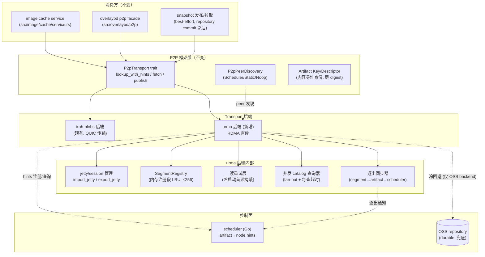
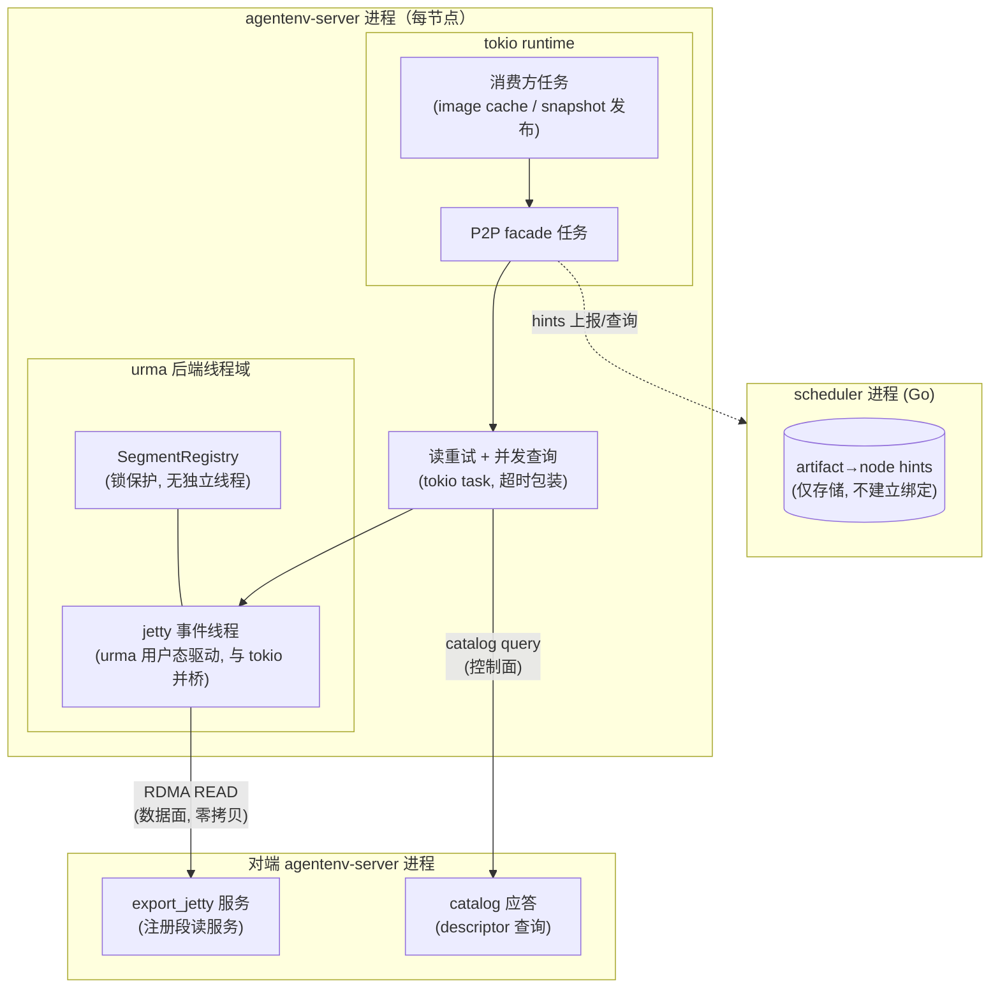
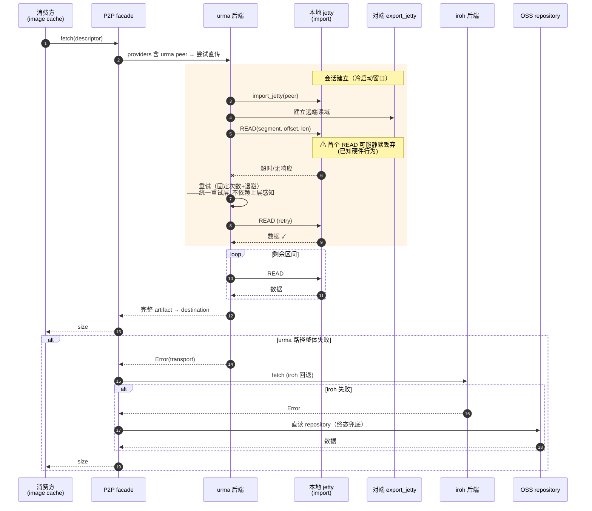
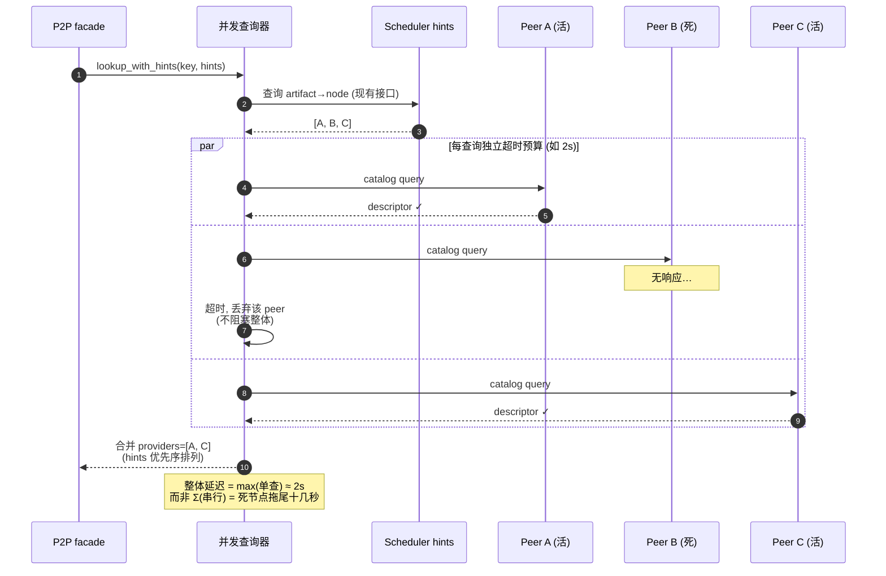
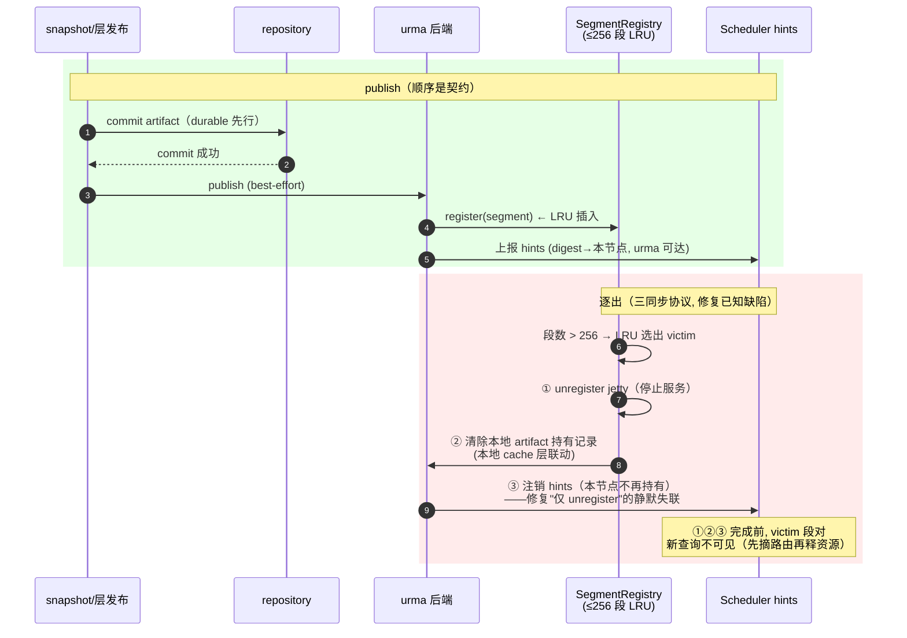
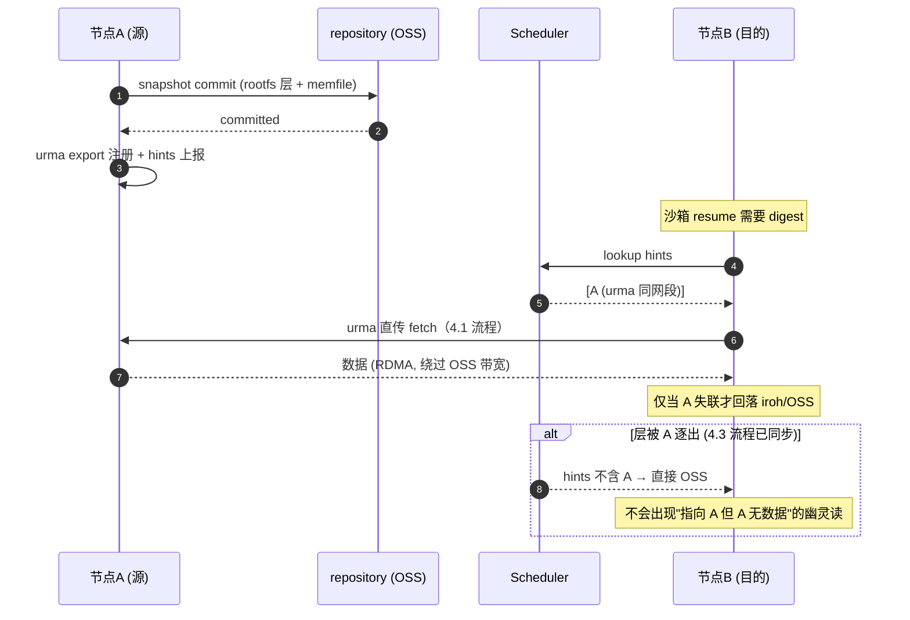

# AgentENV P2P 框架 urma 加速层 — 设计文档

> 基于 master_main 代码现状（v0.2.5+）。P2P 框架已存在：`src/p2p/`（trait 抽象 + iroh 后端 + scheduler 发现），urma 加速作为**新增 transport 后端**接入。Mermaid 图可直接在 GitHub / VS Code 预览。

---

## 0. 现状盘点（设计基线）

```text
src/p2p/
├── transport.rs      P2pTransport trait（lookup/fetch/publish 抽象）
├── types.rs          P2pArtifactKey/Descriptor/Provider/FetchOptions
├── config.rs         P2pTransportKind::{Disabled, Iroh}  ← 扩展点
├── discovery/
│   ├── scheduler.rs  SchedulerPeerDiscovery（scheduler gRPC 发现）
│   └── mod.rs        Static/Noop 发现
├── iroh/             iroh-blobs 后端（现有唯一实传输后端）
└── mock.rs

src/overlaybd/p2p/    层身份（artifact.rs）+ cache + facade
services/             scheduler 存储 artifact→node hints（仅路由提示）
```

**现有约束（来自项目经验，设计必须解决）：**

| 已知问题 | 设计对策 |
| --- | --- |
| urma import_jetty 后首个 READ 可能硬件静默丢弃；冷启动窗口仅在目录查询路径有重试掩盖 | 读路径统一重试层（§4.1） |
| 单 peer catalog 串行查询，死节点十几秒拖尾（urma 发现链路修复后变显性） | 并发查询 + 超时预算（§4.2） |
| SegmentRegistry 256 段 LRU 仅 unregister，不同步 artifact 持有与 scheduler 记录 → 冷 artifact 幽灵源 | 逐出三同步协议（§4.3） |
| P2P 只加速访问，durable 记录在 repository；POSIX 不得从 peer 修复缺失文件 | 回退链终点始终是 repository（§3） |

---

## 1. 模块视图（urma 后端在 P2P 框架中的位置）



**接入方式**：`P2pTransportKind` 增加 `Urma` 变体（[src/p2p/mod.rs transport_from_config](file:///Users/cheney/work/code/AgentENV/src/p2p/mod.rs) 分支），或 `Urma` 作为 iroh 的**加速旁路**（hints 命中同网段 urma peer 时优先直传，miss 回落 iroh）——后者为推荐形态，两种后端互补而非互斥。

---

## 2. 进程视图



**进程/线程要点：**

| 组件 | 位置 | 模型 |
| --- | --- | --- |
| P2P facade / 消费方 | agentenv-server tokio | 现有 async 任务，零改动 |
| urma jetty 事件驱动 | agentenv-server 专用线程 | urma 用户态verbs的完成事件线程；与 tokio 通过 channel 桥接（`spawn_blocking` / oneshot） |
| 读重试 + 并发查询 | tokio task | 包装层，无自有线程 |
| SegmentRegistry | 进程内共享结构 | `Mutex<HashMap>` + LRU；**逐出钩子同步触发**（§4.3） |
| export_jetty 服务 | 对端 agentenv-server | 每远端会话一个 jetty；内存注册段引用计数 |
| scheduler hints | Go 独立进程 | 现有 gRPC 接口复用，新增 urma 可达性标记 |

---

## 3. 数据流：fetch 的回退链（核心语义）

```text
P2pTransport::fetch(descriptor)
  ① descriptor.providers 里的 urma peer（hints 优先序）
     └─ RDMA READ 直传（零拷贝, 同网段 μs 级）
  ② urma 传输失败/超时 → iroh 后端（QUIC, 跨网段兜底）
  ③ iroh 也失败 → repository（OSS backend 直读）
     ⚠ POSIX backend 不从 peer 修复缺失文件（现有约束）
  publish: repository commit 完成 → 才上报 hints → urma export 注册（best-effort）
```

---

## 4. 关键时序图

### 4.1 fetch 加速路径（含冷启动重试）



### 4.2 lookup 并发查询（消除死节点拖尾）



### 4.3 publish 与 SegmentRegistry 逐出同步（堵幽灵源）



### 4.4 端到端：快照发布 → 跨节点 P2P resume 加速



---

## 5. 模块改动清单

| 位置 | 改动 | 量级 |
| --- | --- | --- |
| `src/p2p/config.rs` | `P2pTransportKind` + `Urma`（或 `IrohWithUrmaBypass`） | 小 |
| `src/p2p/urma/`（新增） | jetty 会话管理、SegmentRegistry（修三同步）、读重试层、并发查询器 | 大 |
| `src/p2p/iroh/transport.rs` | 回退链编排（urma miss → iroh → repository） | 中 |
| `src/overlaybd/p2p/artifact.rs` | 层身份复用（digest 既是 P2P key 又是 urma 段键） | 小 |
| `services/` scheduler | hints 表加 transport 可达性标记；逐出注销接口 | 小 |
| `src/cfg.rs` + `config/default.toml` | `[p2p.urma]` 段（段上限/查询超时/重试参数） | 小 |
| 内核 / pageout / ublk 数据面 | **零改动** | — |

## 6. 验证方案

```text
Phase 0  重试层单测：mock 首读丢弃 → 验证掩蔽与退避参数
Phase 1  双节点直传：层 fetch 延迟对比 (urma vs iroh vs OSS 直读)
         + 死节点注入：lookup 整体延迟 ≤ 单查超时（消除拖尾）
Phase 2  逐出协议：灌 300+ 段触发 LRU → 验证三同步后无幽灵 hints
Phase 3  回退链 E2E：kill urma 路径 → iroh 顶上 → kill iroh → OSS 兜底，
         全程 fetch 不失败
KPI: 同网段 fetch p99 相对 iroh 改善 ≥ 2x；
     publish→可发现 时延（hints 上报后）< 1s；
     死节点 lookup 拖尾从 ~10s+ 降到 ≤ 查询超时预算
```
