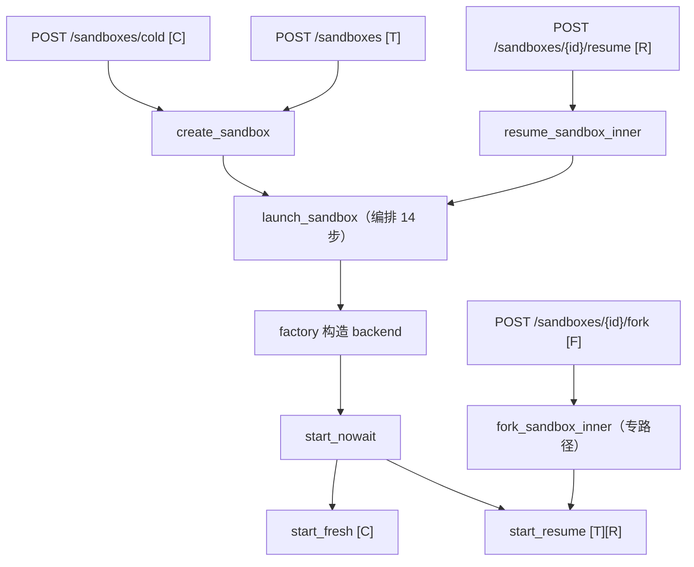

# 沙箱拉起全流程

AgentENV 沙箱拉起（launch）完整代码地图，覆盖四个入口变体：**[T]** 模板快照热启动、**[C]** OCI 冷启动、**[F]** fork、**[R]** resume。设备创建细节见 [[Ublk 设备管理]]，pause/resume 深入分析见 [[Pause-Resume 流程与代码地图]]。

## 0. 汇聚结构

[T]/[C]/[R] 经 `launch_sandbox`（`src/orchestrator/service.rs:2562`）汇聚，差别只在 LaunchPlan（`src/orchestrator/launch_plan.rs:40` enum；`for_resume` `:84`；transitional_state `:107`——Create→`Creating`，Resume→`Resuming`）；[F] 独立路径。

## 1. API 层（进入 orchestrator 之前）

鉴权：`require_auth`（`src/api/impls/auth.rs:43`），`x-api-key` header（`src/api/impls/auth.rs:13`），`/health`、`/metrics` 豁免。

**关键发现：模板 artifact 解析/下载发生在 API handler 内、create 之前（同步阻塞）。**

| 项 | 锚点 | 说明 |
| --- | --- | --- |
| [C] 入口 | `src/api/impls/sandbox.rs:666` | `POST /sandboxes/cold`，timer `create_cold` |
| [T] 入口 | `src/api/impls/sandbox.rs:1014` | `POST /sandboxes`（v2 包装 `:1201` 委托 v1） |
| [F] 入口 | `src/api/impls/sandbox.rs:1440` | `POST /sandboxes/{id}/fork` |
| [R] 入口 | `src/api/impls/sandbox.rs:1953` | connect 隐式 resume `:1374` |
| [T] artifact 物化 | `src/snapshot/repository/backends/oss/resolver.rs:100` | vm_state **先 P2P**（`:126`）失败回退 OSS（`:137`）；内存/rootfs image.json `:152-187`；本地缓存 `src/snapshot/artifact_cache.rs:114` |
| [T] POSIX 后端 | `src/snapshot/repository/backends/posixfs/runtime.rs:68` | 本地路径直解，不走 P2P（契约：POSIX 禁止从 peer 修复） |
| [C] OCI 解析 | `src/image/resolver.rs:191` | 候选 registry 循环 `:205-245`（regctl）；**overlaybd-native referrer 优先** `:273-305`；404 全候选→4xx |
| [C] 资源校验 | `src/api/impls/sandbox.rs:503` | mem≥128、disk≥1024 且整除 |
| [C] 附加盘 | `src/api/impls/sandbox.rs:702-721` | 同走 ImageResolver |
| 网络策略 | `src/api/impls/sandbox.rs:600` | IPv6 CIDR 拒绝 `:631`、域名 allowlist `:644` |
| 卷预留 | `src/api/impls/sandbox.rs:141` | owner=`pending-{uuid}`；成功后 `replace_owner_for`→sandbox_id（`:810-831`）；失败 `:185` 清理。[T] 快照卷恢复 `:292`；[F] 子卷 `:191` |

分叉组装 `CreateSandboxRequest`：[T] `SandboxLaunchSource::Snapshot`（`src/api/impls/sandbox.rs:1128-1149`）；[C] `SandboxLaunchSource::Image`（`:770-803`）。

## 2. Orchestrator：create → LaunchPlan

| 项 | 锚点 | 说明 |
| --- | --- | --- |
| 入口（取消安全壳） | `src/orchestrator/service.rs:425` | `run_cancellation_safe`（`:289`）spawn 隔离，调用方取消不中止操作 |
| shutdown 守卫 | `src/orchestrator/service.rs:3174` | create 检查点 `:460` |
| [T] Snapshot 分支 | `src/orchestrator/service.rs:487-553` | 虚拟化模式一致性 `:490`；MMDS 注入 `:500-503`；`LaunchPlan::for_create_from_snapshot` `:544` |
| [C] Image 分支 | `src/orchestrator/service.rs:554-619` | `FreshSandboxBuildSpec` `:582`；`for_create_fresh` `:610` |
| 事件 | `src/orchestrator/service.rs:622-636` | `publish_sandbox_event(Create)` `:625` |

## 3. launch_sandbox 编排 14 步（`src/orchestrator/service.rs:2562`）

| # | 步 | 锚点 | 说明 |
| --- | --- | --- | --- |
| 1 | build backend | `src/orchestrator/service.rs:2578` | 分派：[T] `build_from_snapshot` / [C] `build` / [R] `build_from_paused_state`（fn `:2862`） |
| 2 | 保护启动期 artifact | `src/orchestrator/service.rs:2588-2601` | `protect_image_refs(StartingSandbox)`，防本地镜像 GC 删 layer |
| 3 | `start_nowait` | `src/orchestrator/service.rs:2602` | 异步启动 VM；失败→stop+回滚 |
| 4 | 二次 shutdown 检查 | `src/orchestrator/service.rs:2618-2626` | |
| 5 | **注册内存 handle（先于 store）** | `src/orchestrator/service.rs:2637-2641` | `sandboxes.write().insert` 顺序关键 |
| 6 | 释放启动期 pin | `src/orchestrator/service.rs:2643` | |
| 7 | **持久化过渡态** | `src/orchestrator/service.rs:2647-2654` | `store.add`（Creating/Resuming） |
| 8 | `wait_for_ready` | `src/orchestrator/service.rs:2665-2668` | envd 就绪，见 §6 |
| 9 | start_paused 分支 | `src/orchestrator/service.rs:2692-2787` | 迁移专用：boot 后立即 pause+persist+摘 handle+stop |
| 10 | **CAS 到终态** | `src/orchestrator/service.rs:2803-2823` | `update_if_state`→Running/Paused，落 timeout |
| 11 | 提取 proxy target | `src/orchestrator/service.rs:2830-2843` | `host_interaction_ip`（fn `:2987`） |
| 12 | 发布路由 | `src/orchestrator/service.rs:2844-2849` | 锁序 sandboxes→proxy_routes（注释 `:3022-3023`） |
| 13 | [R] 删 paused 记录 | `src/orchestrator/service.rs:2852-2856` | `persister.delete_record` |
| 14 | 完成 | `src/orchestrator/service.rs:2858` | |

## 4. Backend 构造（factory，纯对象构造不启动 VM）

| 项 | 锚点 | 说明 |
| --- | --- | --- |
| [C] `build` | `src/sandbox/firecracker/factory.rs:78` | 可写 LogStructured upper `:83-87`；ublk 配置 `:102-106`；**boot args 白名单过滤** `:119-132`（fn `:47`） |
| [C] `new_with_id` 卷槽分区 | `src/sandbox/firecracker/sandbox.rs:764` | 物理/卷盘分离，保留卷槽位 |
| [T] `from_snapshot` | `src/sandbox/firecracker/sandbox.rs:859` | `snapshot_config_for_launch`（`:892`）；launch 期 extra_drives 追加 `:903`；新卷待 envd 就绪后 guest 内挂载 `:874` |
| [R] `from_snapshot_config_with_override` | `src/sandbox/firecracker/sandbox.rs:812` | legacy 快照盘数校验 `:817`；MMDS token 重写 `:834` |
| 对象构造 | `src/sandbox/firecracker/sandbox.rs:1812` | work_dir + `FirecrackerInstance::new` + `LaunchMode`（`:2863`） |

## 5. start_nowait → start_fresh / start_resume

公共前奏（`src/sandbox/firecracker/sandbox.rs:947`）：tools 盘 `prepare_tools_drive`（`:957`，共享只读设备）→ 校验 → 分派（`:951-954`）。

### 5a. start_fresh [C]（`src/sandbox/firecracker/sandbox.rs:1851`）

| # | 步 | 锚点 |
| --- | --- | --- |
| 1 | tools symlink | `src/sandbox/firecracker/sandbox.rs:1860`（fn `:2435`） |
| 2 | **rootfs overlaybd 运行时设备** | `src/sandbox/firecracker/sandbox.rs:1871-1883`（symlink 失败即回滚 `:1888-1898`） |
| 3 | boot args `init=/init` | `src/sandbox/firecracker/sandbox.rs:1907-1920` |
| 4 | extra drives（含卷） | `src/sandbox/firecracker/sandbox.rs:1922-1944`（`src/sandbox/extra_drive.rs:432`，Fresh 模式 `:370`） |
| 5 | **网络槽分配** | `src/sandbox/firecracker/sandbox.rs:1952-1961`（`NetworkManager::allocate_any` `src/sandbox/network/manager.rs:237`：warm 池快路径 `:242`；慢路径 iptables `:264`）；`ip=` boot 参数 `:1961`；egress 策略 `:1964` |
| 6 | **extension start-fresh 钩子** | `src/sandbox/firecracker/sandbox.rs:1975-1991`（`src/sandbox/custom_extension/client.rs:262`，失败 fail 操作） |
| 7 | DAMON 参数 | `src/sandbox/firecracker/sandbox.rs:1993` |
| 8 | **spawn FC（带 netns）** | `src/sandbox/firecracker/sandbox.rs:2000-2007`（`src/sandbox/firecracker/instance.rs:64`：setns `:120-130`、oom_score_adj=1000 `:137-142`） |
| 9 | envd 实例 | `src/sandbox/firecracker/sandbox.rs:2009-2016` |
| 10 | 等 API socket | `src/sandbox/firecracker/sandbox.rs:2019-2024`（`src/sandbox/firecracker/instance.rs:149`） |
| 11 | configure_microvm + InstanceStart | `src/sandbox/firecracker/sandbox.rs:2025-2027` → §5c |

### 5b. start_resume [T][R]（`src/sandbox/firecracker/sandbox.rs:2033`）

| # | 步 | 锚点 |
| --- | --- | --- |
| 1 | ublk 可用性预检 | `src/sandbox/firecracker/sandbox.rs:2042-2046`（fail-fast） |
| 2 | **warm pool 采纳** | `src/sandbox/firecracker/sandbox.rs:2061-2088`（`try_acquire`；采纳 slot/work_dir/fc_instance） |
| 3 | tools/rootfs 设备 | `src/sandbox/firecracker/sandbox.rs:2100-2142`（rootfs：known 尺寸、allow_shrink=false） |
| 4 | 快照 backing extra drives | `src/sandbox/firecracker/sandbox.rs:2145-2148`（Resume 模式） |
| 5 | 卷槽占位与绑定 | `src/sandbox/firecracker/sandbox.rs:2152-2179`（4KB 占位 `:2612-2629`；已有卷 load 前替换 `:2649`） |
| 6 | 网络（无 warm 时） | `src/sandbox/firecracker/sandbox.rs:2182-2211` |
| 7 | **extension start-resume 钩子** | `src/sandbox/firecracker/sandbox.rs:2216-2232`（`src/sandbox/custom_extension/client.rs:293`；pack_recording 豁免 `:2216`） |
| 8 | **内存设备**（三选一） | 共享 `src/sandbox/firecracker/sandbox.rs:2308-2317`；pack_recording 专用 `:2251-2288`；startup-pack 预取 `:2294`/`:2329` |
| 9 | **`load_snapshot_file`** | `src/sandbox/firecracker/sandbox.rs:2356-2364`（`src/sandbox/firecracker/instance.rs:522`，mem backend=File，eth0→tap0 覆盖）——**resume 大头** |
| 10 | 新卷 PATCH 挂载 | `src/sandbox/firecracker/sandbox.rs:2369-2387` |
| 11 | MMDS + 限速对账 + resume | `src/sandbox/firecracker/sandbox.rs:2388-2403`（`fc_instance.resume` `src/sandbox/firecracker/instance.rs:455`） |

[T] 与 [R] 都走 `start_resume`，区别仅在配置来源：[T] 来自模板快照解析，[R] 来自 paused 时原样持久化的 `FirecrackerSnapshotConfig`。

### 5c. configure_microvm [C]（`src/sandbox/firecracker/sandbox.rs:2476`）

machine-config（mem/vcpu/**track_dirty_pages**）`:2484-2491` → cpu-config `:2493` → boot-source `:2499` → **Drive0 vda tools 只读** `:2505-2522` → **Drive1 vdb 用户 rootfs 可写+限速器** `:2524-2537` → extra drives+卷槽 `:2539-2566`（卷用稳定保留槽：快照后不能新增 virtio-blk，注释 `:2540`） → 网卡+MMDS `:2568-2582` → balloon（free page reporting）`:2588` → InstanceStart `:2027`。FC 24 盘上限：`src/sandbox/firecracker/config.rs:55`。

## 6. envd 就绪与收尾（backend `wait_for_ready`，`src/sandbox/firecracker/sandbox.rs:982`）

| 步 | 锚点 | 说明 |
| --- | --- | --- |
| 健康探测循环 | `src/sandbox/firecracker/sandbox.rs:983-991` → `src/sandbox/envd.rs:118` | `health_get` 探测，超时=envd_timeout |
| 释放后台下载保持 | `src/sandbox/firecracker/sandbox.rs:992-1010` | tools/mem/rootfs 三处 `notify_sandbox_ready`，layer 后台下载至此可结束 |
| envd init | `src/sandbox/firecracker/sandbox.rs:1011-1017`（`src/sandbox/envd.rs:163`） | env vars/workdir/USER |
| [T] 新卷 guest 内挂载 | `src/sandbox/firecracker/sandbox.rs:1021-1027`（`:1032`） | ro 卷用 `ro,noload` 抑制 journal replay（`:1053-1061`） |

## 7. Fork 专路径（不走 launch_sandbox）

| 步 | 锚点 | 说明 |
| --- | --- | --- |
| API 侧 | `src/api/impls/sandbox.rs:1440-1589` | 源卷 snapshot+recover `:1476`；子规格 `:1513`；失败子卷清理 `:1541-1550` |
| orchestrator | `src/orchestrator/service.rs:685` | 子 ID 检查 `:696`；**源 CAS Running→Forking** `:717`；每子独立 envd token `:735` |
| backend fork | `src/sandbox/firecracker/sandbox.rs:535` | **先 pause 源再 resume 源**（`:539`/`:544`）；子配置 `snapshot_config_for_fork`（`:334`，卷替换 `:343`，不允许追加物理盘 `:362`）；子并发 join_all `:575`，单个失败即 stop 该子 `:580` |
| 子注册循环 | `src/orchestrator/service.rs:799-853` | metadata 克隆改 id → store.add → sandboxes.insert → 路由 → Fork 事件 |

子 VM 内存来自源 pause 时的共享内存设备（引用计数在 `UblkDeviceManager`，见 [[Ublk 设备管理]]）；exclusive 卷换子卷，boot 走 start_resume 同款路径。

## 8. Warm Pool

| 项 | 锚点 | 说明 |
| --- | --- | --- |
| 定义 | `src/sandbox/firecracker/pool.rs:51` | 一个 warm 条目=网络槽+运行中 FC 进程+work_dir 的不可分所有权单元（`:45-49`） |
| 启用 | `src/sandbox/firecracker/pool.rs:64` | `[pool.firecracker].enabled`；初始化失败静默回退冷 spawn `:70` |
| 采纳时机 | **仅 start_resume**：`src/sandbox/firecracker/sandbox.rs:2063-2088` | 跳过 spawn 与 API socket 轮询；低水位触发补充 `src/sandbox/firecracker/pool.rs:146-148` |
| 预热 | `src/sandbox/firecracker/pool.rs:298` | 维护线程 `:132`；网络 slot 也有独立 warm 池（`src/sandbox/network/manager.rs:242-253`） |

## 9. 失败回滚

| 项 | 锚点 | 说明 |
| --- | --- | --- |
| 阶段模型 | `src/orchestrator/service.rs:92-111` | `FailedLaunchStage::{Registered, TransitionalPersisted, RunningPersisted}` |
| `cleanup_failed_launch` | `src/orchestrator/service.rs:2888` | detach（**handle 指针同一性检查** `:2966` 防误删替代者）→ stop → 按阶段回滚：Create→`store.remove`，Resume→恢复 Paused+`rollback_resuming` |
| backend stop 顺序 | `src/sandbox/firecracker/sandbox.rs:1472-1569` | prefetch 取消→FC stop→envd invalidate→rootfs 设备释放→tools 释放→专用 mem 删除→extra drives→extension stop→网络→mem 共享设备（注释：ublk 清理须在 FC stop 后、网络清理前 `:1500`） |
| Drop 兜底 | `src/sandbox/firecracker/sandbox.rs:1783` | `src/sandbox/firecracker/instance.rs:563` Drop 杀进程 |
| API 层卷回滚 | `src/api/impls/sandbox.rs:840-866`（[C]）/ `:1185-1197`（[T]） | 预留 owner 归还/删除 |

## 10. 并发守卫与 TTL

- 状态机全 CAS：Creating/Resuming→Running（`src/orchestrator/service.rs:2803`）；Fork Running→Forking→Running（`:719`/`:786`）；Resume Paused→Resuming→Running（`:1704`）
- 过渡态等待 60s（`src/orchestrator/service.rs:64`），并发 resume 合流 `join_concurrent_resume`（`:1719`）
- handle 表 `RwLock<HashMap>`（`src/orchestrator/service.rs:121`）；删除互斥 `deletions`（`:123`，auto-evict 抢占 Killing 前取锁 `:2447`）
- TTL/auto-pause：创建时 timeout/timeout_action 落盘 `update_timeout`（`src/orchestrator/service.rs:2811`）；auto-evict 任务 `:2481`（分派 `:2453-2459`）

## 11. 未展开（诚实标注）

`prepare_extra_drives` 设备创建细节、`Slot::create_network` 的 TAP/iptables 细节、`crates/warm-pool/` 池算法本体、`from_runnable_snapshot` 字段映射（`src/sandbox/firecracker/config.rs:483`）仅到函数级锚点，未逐行读。
